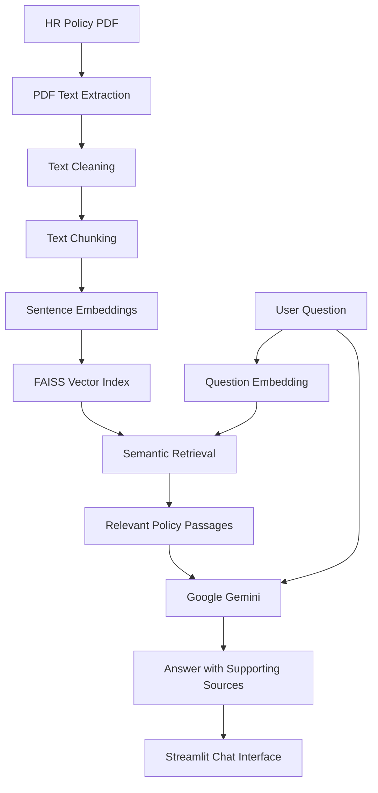

# PeoplePilot — AI-Powered HR Policy Assistant

**HR answers, made simple.**

PeoplePilot is an AI-powered HR Policy RAG chatbot that helps employees find clear, relevant answers to workplace policy questions using information retrieved from an HR handbook. Instead of manually searching lengthy policy documents, users can ask questions in natural language and receive AI-generated responses grounded in relevant document passages.

**Live Demo:** [Try PeoplePilot](https://peoplepilot-ai-hr-policy-assistant.streamlit.app/)  
**GitHub Repository:** [PeoplePilot-AI-HR-Policy-Assistant](https://github.com/samirmore7/PeoplePilot-AI-HR-Policy-Assistant)

---

## ✨ Key Features

- **Natural Language Q&A:** Ask workplace policy questions conversationally.
- **Retrieval-Augmented Generation (RAG):** Retrieve relevant handbook content before generating an answer.
- **Semantic Search:** Use sentence embeddings and FAISS to find contextually relevant passages.
- **Source-Grounded Responses:** Display supporting passages so users can verify the information behind an answer.
- **Multilingual Interface:** Support for 10 language options.
- **Customizable Themes:** Choose from Midnight, Light, Ocean, and Lavender themes.
- **Suggested Questions:** Explore common HR policy questions to get started.
- **Interactive Chat Interface:** Ask follow-up questions through a Streamlit-based interface.
- **Error Diagnostics:** Provide technical diagnostic details to assist with troubleshooting.

## 🛠️ Technology Stack

| Component | Technology |
|---|---|
| Programming Language | Python |
| Frontend and UI | Streamlit |
| Large Language Model | Google Gemini (`gemini-2.5-flash`) |
| Embedding Model | `sentence-transformers/all-MiniLM-L6-v2` |
| Vector Search | FAISS |
| Document Processing | PDF extraction and text cleaning |
| Data Processing | JSON |
| Environment Configuration | python-dotenv |
| Version Control | Git and GitHub |
| Deployment | Streamlit Community Cloud |

## 🏗️ System Architecture

PeoplePilot follows a Retrieval-Augmented Generation architecture that combines semantic retrieval with large language model generation.



### How It Works

1. **Document ingestion:** Extract text from the HR policy PDF.
2. **Text preprocessing:** Clean the extracted text and prepare it for retrieval.
3. **Chunking:** Divide the document into smaller, overlapping text segments.
4. **Embedding generation:** Convert text chunks into numerical vector representations.
5. **Vector indexing:** Store embeddings in a FAISS index for similarity-based retrieval.
6. **Question processing:** Convert the user's question into an embedding and retrieve relevant chunks.
7. **Answer generation:** Pass the question and retrieved context to Google Gemini.
8. **Response presentation:** Display the generated answer and available supporting passages in the Streamlit interface.

## 📊 Document Processing Details

The current HR policy document processing pipeline produces the following artifacts:

| Metric | Value |
|---|---:|
| Source document | 32-page HR policy PDF |
| Cleaned text | Approximately 48,997 characters |
| Text chunks | 122 |
| Chunk size | 500 |
| Chunk overlap | 50 |
| Embedding dimensions | 384 |

These values describe the current processed document and can change if the source handbook or chunking configuration changes.

## 📁 Project Structure

```text
PeoplePilot-AI-HR-Policy-Assistant/
│
├── app.py
├── pdf_reader.py
├── text_cleaner.py
├── text_chunker.py
├── embeddings.py
├── vector_store.py
├── retriever.py
├── rag_chain.py
├── check_models.py
├── requirements.txt
├── README.md
├── .gitignore
│
└── data/
    ├── hr_policy.pdf
    ├── hr_policy.index
    └── chunks.json
```

### Core Modules

- `app.py` — Streamlit user interface, themes, chat interaction, and response display.
- `pdf_reader.py` — Extracts text from the source PDF.
- `text_cleaner.py` — Cleans extracted text.
- `text_chunker.py` — Splits the text into overlapping chunks.
- `embeddings.py` — Generates vector embeddings.
- `vector_store.py` — Creates the FAISS vector index and saves processed chunks.
- `retriever.py` — Loads the vector store and retrieves relevant passages.
- `rag_chain.py` — Connects retrieved context with the Gemini model to generate answers.
- `check_models.py` — Supports model and environment checks.
- `requirements.txt` — Lists Python dependencies.
- `data/` — Contains the source policy PDF and generated retrieval artifacts.

## 🚀 Run Locally

### Prerequisites

- Python 3.11 recommended for a compatible deployment environment.
- Git.
- A Google Gemini API key.

### 1. Clone the repository

```bash
git clone https://github.com/samirmore7/PeoplePilot-AI-HR-Policy-Assistant.git
cd PeoplePilot-AI-HR-Policy-Assistant
```

### 2. Create and activate a virtual environment

**Windows PowerShell**

```powershell
python -m venv .venv
.\.venv\Scripts\Activate.ps1
```

### 3. Install dependencies

```bash
python -m pip install --upgrade pip
pip install -r requirements.txt
```

### 4. Configure the Gemini API key

Create a `.env` file in the project root:

```env
GEMINI_API_KEY=your_gemini_api_key_here
```

Replace the placeholder with your own API key. Never commit your real `.env` file or publish your API key.

### 5. Launch the application

```bash
python -m streamlit run app.py
```

Open the local URL displayed in your terminal, typically `http://localhost:8501`.

> If you modify the source handbook or text-processing configuration, regenerate the document chunks and FAISS index using the project's processing modules before running the application.

## ☁️ Deployment

PeoplePilot is configured for deployment through Streamlit Community Cloud.

1. Push the project to GitHub.
2. Create an app at [Streamlit Community Cloud](https://share.streamlit.io/).
3. Select the repository, `main` branch, and `app.py` as the main file.
4. Add the following under the app's **Settings → Secrets**:

```toml
GEMINI_API_KEY = "your_actual_gemini_api_key"
```

5. Save the settings and allow Streamlit Cloud to deploy the application.

Ensure the required FAISS index and chunk files are included in the repository or are generated during deployment. Keep API keys and other secrets out of source control.

## 🔐 Security and Responsible Use

- Store API keys in environment variables or deployment secrets.
- Never commit `.env` files containing credentials.
- Treat generated answers as informational assistance, not authoritative HR or legal decisions.
- Verify important policy decisions against the original handbook and consult the appropriate HR representative.
- Use only policy documents that you are authorized to process and share.

## 🔮 Potential Future Enhancements

- Upload and index multiple HR policy documents.
- Add document-level filtering and more detailed source references.
- Improve retrieval using hybrid search and reranking.
- Introduce automated evaluation for answer relevance and faithfulness.
- Add conversation history persistence and user feedback.
- Expand support for additional languages and document formats.
- Add monitoring for latency, retrieval quality, and model usage.

## 🎯 Project Objective

PeoplePilot demonstrates how Retrieval-Augmented Generation can make organizational knowledge more accessible by connecting document processing, semantic search, vector databases, and large language models through an interactive application.

The project brings together practical skills in Python, NLP, embeddings, vector search, prompt engineering, API integration, and application deployment.

---

**Built with Python, FAISS, Sentence Transformers, Google Gemini, and Streamlit.**

[Live Demo](https://peoplepilot-ai-hr-policy-assistant.streamlit.app/) · [GitHub Repository](https://github.com/samirmore7/PeoplePilot-AI-HR-Policy-Assistant)

